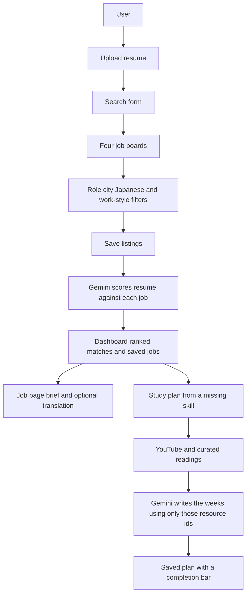

# Option A required components

Job Analyzer is a Generative AI application for people looking for work in Japan. A user uploads a resume, searches live job boards, and Gemini scores each listing against that resume. Missing skills become a study plan with real videos and readings. The six sections below are the required components only.

## 1. Problem definition

Job seekers in Japan face a matching problem, not a search problem. A single keyword returns listings in English and Japanese, with Japanese-level requirements buried in long descriptions, and no indication of whether the role fits the person's actual resume. Reading every page and guessing a match wastes time and leads people to apply for jobs that are too senior, too junior, or above their Japanese level.

The target users are students and early-career candidates applying for work in Japan, including international students. They have a resume, a Japanese level from "no Japanese" to native, and a short list of roles they can do. They need the result in the language they read more easily.

Generative AI fits this problem because the comparison is semantic. A resume and a job description do not share a fixed form. Gemini can read both and return a compatibility score, the skills that overlap, the skills that are missing, and a short reason. The same model can turn a missing skill into a week-by-week plan and can translate a job page without changing the saved listing. The jobs themselves are not generated. They are retrieved from real boards, then the model only judges and explains them. That split is why Generative AI is appropriate: generation is used for judgment, explanation, translation, and study planning, while the facts about openings come from the source pages.

## 2. Workflow design

The user signs in and uploads one resume. PDF or Word text is extracted and stored for that account. On the search page they choose up to four roles, a work style, a Japanese ceiling, an experience level, and a city. The API asks Mynavi, CareerCross, Career Forum, and GaijinPot for listings. Each board can fail on its own. The results are merged, then kept only when the title matches a chosen role, the city matches, the Japanese requirement is at or below the user's ceiling, and the seniority and work style fit. Unknown Japanese requirements are kept, so a listing is not dropped just because the page never stated a level.

Saved listings are scored in small batches. Gemini receives the resume text and the job text and must return JSON: a score from 0 to 100, matching skills, missing skills, a suggestion, and a short explanation. The dashboard ranks the scored jobs and lists saved jobs separately. Opening a job builds a short brief from the text already on the page: a summary, the Japanese requirement, other skills, and application dates when they are written in the listing. Choosing English or Japanese sends that same page to Gemini for a full translation. The saved record is not overwritten.

A missing skill can start a study plan. The server first looks up real YouTube videos and curated readings, then asks Gemini to arrange those items into weeks. The model is told the resource ids and is told not to write URLs. If the model fails or runs out of time, a template plan is saved instead. The plan stays on the skill card with a completion bar.

## 3. Knowledge base

No single document set was handed in at the start. The application uses live sources plus one curated catalog. These are the sources, with links to check.

Live job listings, retrieved at search time:

- Mynavi Tenshoku, mid-career listings: https://tenshoku.mynavi.jp/
- Mynavi new-graduate search: https://job.mynavi.jp/
- CareerCross English listings: https://www.careercross.com/en/
- Career Forum public company and job pages: https://careerforum.net/en/company_list/ and the public company API at https://careerforum.net/api/public/companies
- GaijinPot Jobs: https://jobs.gaijinpot.com/

The candidate's own resume is the second source. Each user contributes one PDF or Word file. It is the only personal document the scorer reads.

Study materials are the third source:

- YouTube Data API for real videos, searched by skill: https://developers.google.com/youtube/v3. A video is opened on YouTube only after the user clicks it.
- A curated catalog of 55 reading links in `backend/data/skill_resources.json`, covering 21 technical skills plus JLPT levels. Examples to check: the Python tutorial at https://docs.python.org/3/tutorial/index.html, the JLPT level summary at https://www.jlpt.jp/e/about/levelsummary.html, and Tae Kim's grammar guide at https://guidetojapanese.org/learn/grammar. If a skill is not in the catalog, the plan gets a Google search link for that skill's official documentation, not a made-up article URL.

Gemini, through Google AI Studio, is the model that reads these inputs: https://aistudio.google.com/. It is not treated as a document source. It is not allowed to invent job URLs or study URLs.

These sources were selected because they match the users. Mynavi covers the Japanese-language market. GaijinPot and CareerCross cover English-language jobs in Japan. Career Forum covers company events and public job records without requiring a login. Official documentation and the JLPT site are stable places to learn a missing skill. YouTube supplies a current video when a catalog page would go out of date.

Limits are part of the design. Listings change daily, and a page can block the scraper. CareerCross often returns nothing because of a bot check, while the other boards still return results. A search keeps only a small set of matching titles, so the knowledge base for one session is a handful of pages, not a complete archive. Job text is sometimes short, and Japanese requirements are often unstated. The resume is only as useful as the file the user uploaded. The reading catalog has 55 links, not a full library, and an unknown skill falls back to a search link. YouTube results depend on the API and can be thin for a rare skill. Gemini can still misread a vague description, which is why scores include an explanation and why plans may only cite ids that were retrieved first.

## 4. Prompt engineering

Many instructions shaped the build. These three show the refinement the rubric asks for: the prompt that set the base, the prompt that fixed functionality and analysis, and the prompt that made the system run smoothly.

**Initial prompt.** This set the base of the search the rest of the system depends on.

> for the search job title section i want you to add option feature where people can chose. add these as options: Software Engineer, Data Analyst, AI / Machine Learning Engineer, Sales Representative, Marketing Specialist, Business Analyst, Business Development Associate, Human Resources Specialist, Accountant / Financial Analyst, Customer Support Representative, Administrative Assistant, Project Manager, Mechanical Engineer, Electrical Engineer, Civil Engineer, Graphic / UI Designer, Translator / Interpreter, Teacher / English Instructor, Hotel / Hospitality Staff, Supply Chain / Logistics Specialist. for the location add 3 options like Remote, On-site, Hybrid.

Before this, a free-text title produced loose and inconsistent queries. After it, every search starts from a fixed role list and a fixed work style. Later scoring, city filters, and Japanese-level filters all sit on that same form, so the model is no longer guessing what kind of job the user meant.

**Refined prompt.** This one is about functionality and analysis.

> add a section where i can see my saved jobs too. and it is not analyzing all the jobs. please recheck

The first version could score a listing and still hide two failures. Saved jobs were mixed into the ranked list, and analysis skipped listings that already had an empty score, so "analyze" looked finished when many jobs had never been scored. The revision added a Saved jobs section and changed analysis so a job counts as scored only when it has a real compatibility score. The dashboard can then show which jobs are still waiting. Retrieval was also tightened in the same period so a chosen role has to appear in the title, which gives Gemini a relevant description instead of an unrelated page.

**Final prompt.** This is the pass that made the running system stay usable.

> ok it keeps on lagging. i think we have to change sth. analyzing all the job is causing too much traffic issues for the api to handle

Sending every unscored job to Gemini in one request froze the API, so the dashboard could not load. The final behavior scores three jobs at a time, waits briefly between calls, limits each call to 25 seconds, and leaves the page in place while scoring. The button reads "Score next 3" and shows how many remain. The same idea was applied to study plans: the user can close the builder while it is running, video lookup is capped, and a slow model falls back to a template plan instead of holding the server. The product still analyzes every job, but it does it in steps the API can survive.

## 5. Testing and evaluation

Three checks show the system doing the work it claims to do.

**Test 1. A filtered search returns fitting listings.** Search for one or more of the listed roles, set the city to Tokyo, and set a Japanese ceiling such as Business level. Expected result: titles match the chosen roles, locations match Tokyo or 東京, and a listing that demands native Japanese is left out. A listing that never states a Japanese level still appears. A Kyoto search must not treat 東京都 as Kyoto. An empty result after a strict filter is an empty list, not an "all sources failed" error.

**Test 2. Analysis scores the resume against a real listing.** Open an unscored job and run "Score next 3." Expected result: the job receives an integer score from 0 to 100, a list of matching skills, a list of missing skills, a suggestion, and a short explanation. The dashboard stays visible. A second click scores the next three rather than the ones already scored. If the model is unavailable, the request stops with an error instead of pretending the job was scored.

**Test 3. A study plan is saved and can be reopened.** From a missing skill, build a plan, close it, and choose "View my plan." Expected result: the plan opens under that skill, the completion bar shows done tasks out of total tasks, and week 1 points at a real video or a catalog reading. Closing the view does not delete the plan. If generation is too slow, the user can cancel, and a completed fallback plan is labeled as a template rather than presented as a custom model plan.

## 6. Ethical considerations

Hallucination is the main risk. Gemini could invent a job, a skill, or a study link. The design limits that. Jobs come from the four boards. Study plans may cite only retrieved resource ids, and the model is instructed not to write URLs. Translation is told not to add facts. The on-page brief is parsed from the listing text, and the full description stays available underneath it. A template plan is labeled when the model does not produce a valid plan.

Bias can enter through the role list, the Japanese-level filter, and the score. The role list is a convenience, not a claim that those jobs are the only valid ones. The Japanese filter removes listings above the user's stated ceiling, which can hide jobs a person might still want, so unstated requirements are kept and the user can set the ceiling to Native. The score is an opinion about text similarity. It is not a hiring decision, and the explanation is shown so the user can disagree with it.

Privacy matters because the resume is personal. It is stored for the signed-in user and sent to Gemini only to produce that user's score or plan. API keys stay on the server. Saved listings and plans are tied to the account. Users should treat the score and the plan as private study material, not as something to forward as an official assessment.

Transparency comes from showing the source, the reason, and the limit. Each listing keeps its board and link. The score has an explanation. The study plan shows the video or reading it used. When a board fails or a plan falls back to a template, the interface says so instead of filling the gap with invented content.

Responsible use means the tool helps someone prepare and choose what to read. It does not submit applications, impersonate the user, or guarantee a job. Reliability is handled by scoring three jobs at a time, timing out slow model calls, and letting one blocked board fail without discarding the others. Outputs can still be wrong when the source page is thin, so the user is expected to open the original listing before applying.
